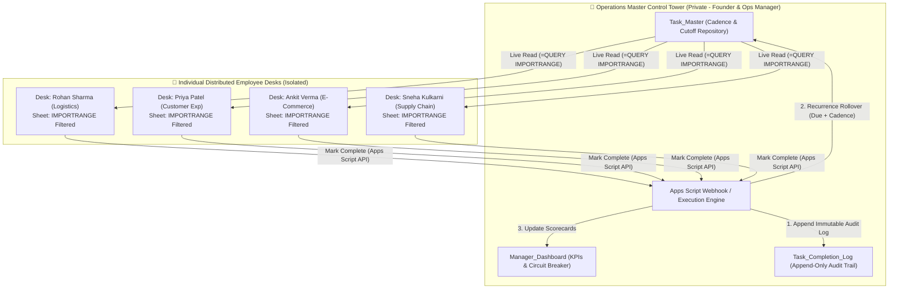

# Allo Innoware Operations Automation System
## Multi-Employee Workforce Access & Desk Isolation Architecture

> **Author:** Vivek Debnath  
> **Role:** Operations & Automation Manager (Founder's Office)  
> **Target System:** Allo Innoware Enterprise Operations Control Tower  

---

## 1. Executive Summary & Problem Analysis

In modern D2C operations at Allo Innoware, daily and recurring workflows span multiple departments—**Logistics**, **Customer Experience (CX)**, **E-Commerce**, and **Supply Chain**. Approximately 4 to 5 team members must track, execute, and verify their operational obligations daily.

### The Multi-User Operational Challenge in Shared Spreadsheets
When multiple employees open a single shared Google Sheet simultaneously:
* **Global Grid Coupling:** If Employee A (Rohan Sharma) changes the filter dropdown in Cell `D1` on `My_Pending_Tasks` to *"Rohan Sharma"*, Google Sheets immediately applies that filter to the live grid for **all simultaneous viewers**.
* **Visual Collision:** If Employee B (Priya Patel) is actively reading her weekly CX portal task at the exact same moment, her screen will abruptly re-render with Rohan's logistics tasks, causing confusion, lost focus, and potential data entry collisions.
* **Confidentiality & Least Privilege:** In enterprise production, frontline staff should strictly view their own operational obligations and never access overall team metrics, managerial escalations, or executive scorecards.

To solve this, we have designed a **three-tier workforce access architecture**, progressing from immediate zero-code in-sheet isolation to enterprise-grade hub-and-spoke multi-workbook decoupling.

---

## 2. Tier 1: Google Sheets Native Private Filter Views (In-Sheet Zero-Friction)

Google Sheets provides a native, highly robust feature specifically engineered for multi-user isolation on the same sheet tab: **Filter Views**.

### How Filter Views Work
Unlike standard sheet filters (which alter the document for everyone), a **Filter View** is executed strictly client-side within the individual user's browser session.

```text
┌────────────────────────────────────────────────────────┐
│               Google Sheet Server Grid                 │
│         (Holds all tasks across all employees)         │
└──────────────────────────┬─────────────────────────────┘
                           │
        ┌──────────────────┴──────────────────┐
        ▼                                     ▼
┌──────────────────────────────┐   ┌──────────────────────────────┐
│  Rohan's Browser Viewport    │   │   Priya's Browser Viewport   │
│  [Filter View: Rohan Sharma] │   │  [Filter View: Priya Patel]  │
│  Shows: ALLO-OPS-101 (Daily) │   │  Shows: ALLO-OPS-102 (Weekly)│
│  Zero impact on Priya's view │   │  Zero impact on Rohan's view │
└──────────────────────────────┘   └──────────────────────────────┘
```

### Setup & Usage for Allo Team Members
1. On `My_Pending_Tasks`, click **Data** in the top Google Sheets menu.
2. Select **Filter views** > **Create new filter view** (or select a pre-configured view: `Filter - Rohan Sharma`).
3. Set the filter condition on Column C (`Assigned Owner`) to match the employee's name.
4. **Result:**
   - Rohan sees only Rohan's tasks.
   - Priya opens the same URL and activates her view, seeing only Priya's tasks.
   - Checking Column H `[x] Mark Complete` executes the Apps Script trigger without disturbing anyone else's filtered screen.

---

## 3. Tier 2: Dynamic Active User Login Detection (`onOpen` Script Engine)

To eliminate the need for employees to manually select a filter view, the system includes an automated identity-detection hook built into Google Apps Script.

### Implementation Mechanism
When any employee opens the Google Sheets workbook, the `onOpen()` event handler reads their authenticated Google Workspace account:

```javascript
function onOpen() {
  // 1. Initialize Custom Operations Menu
  createOperationsMenu_();

  // 2. Automated Employee Desk Isolation
  try {
    const userEmail = (Session.getActiveUser().getEmail() || "").toLowerCase();
    const pendingSheet = SpreadsheetApp.getActiveSpreadsheet().getSheetByName(CONFIG.SHEET_PENDING);
    
    if (pendingSheet && userEmail) {
      let matchedEmp = "";
      if (userEmail.includes("rohan")) matchedEmp = "Rohan Sharma";
      else if (userEmail.includes("priya")) matchedEmp = "Priya Patel";
      else if (userEmail.includes("ankit")) matchedEmp = "Ankit Verma";
      else if (userEmail.includes("sneha")) matchedEmp = "Sneha Kulkarni";
      
      if (matchedEmp) {
        pendingSheet.getRange("D1").setValue(matchedEmp);
        filterPendingDeskByEmployee(pendingSheet, matchedEmp);
      }
    }
  } catch (err) {
    Logger.log("Auto-filter detection exception: " + err.message);
  }
}
```

* **Outcome:** When Rohan Sharma (`rohan.logistics@alloinnoware.com`) accesses the sheet, the desk automatically pre-filters to his logistics queue without requiring manual clicks.

---

## 4. Tier 3: Enterprise Hub-and-Spoke Decoupled Multi-Workbook Architecture (Production Recommendation)

For full enterprise production at scale (10+ employees, sensitive operational SLA tracking, and multi-tier management), the recommended architecture is the **Hub-and-Spoke Multi-Workbook Architecture**.

### Structural Architecture Diagram



### Detailed Component Breakdown

#### A. Central Master Hub (Private)
* **Access Rights:** Strictly restricted to the **Founder / Managing Director** and **Operations Manager**.
* **Contains:**
  1. `Task_Master`: All recurring schedules, IST cutoff configurations, and SLA flags.
  2. `Manager_Dashboard`: Real-time KPI scorecards, unacknowledged breach monitoring, and Manager Circuit Breaker.
  3. `Task_Completion_Log`: Master immutable digital paper trail.

#### B. Individual Employee Child Workbooks (Public to Assignee Only)
* Each team member receives their own separate, dedicated Google Spreadsheet:
  - `Allo_Desk_Rohan_Sharma.gsheet`
  - `Allo_Desk_Priya_Patel.gsheet`
  - `Allo_Desk_Ankit_Verma.gsheet`
  - `Allo_Desk_Sneha_Kulkarni.gsheet`
* In Rohan's sheet, cell `A3` dynamically pulls pending tasks using a protected query:
  ```excel
  =QUERY(
    IMPORTRANGE("https://docs.google.com/spreadsheets/d/MASTER_HUB_ID/edit", "Task_Master!A3:N"),
    "SELECT Col1, Col2, Col3, Col8, Col9 WHERE Col3 = 'Rohan Sharma' AND Col9 != 'COMPLETED'",
    0
  )
  ```

#### C. Bi-Directional Synchronous Completion Protocol
1. When Rohan enters his WhatsApp dispatch confirmation in Column F and checks `[x] Mark Complete` in Column H of his private workbook:
2. An installable `onEdit` trigger in Rohan's sheet calls a secure Google Apps Script Web App endpoint on the Master Hub:
   ```javascript
   function submitCompletionToMasterHub(taskId, proof, remarks, userEmail) {
     const payload = {
       action: "MARK_COMPLETE",
       taskId: taskId,
       proof: proof,
       remarks: remarks,
       userEmail: userEmail,
       token: CONFIG.MASTER_SECRET_TOKEN
     };
     UrlFetchApp.fetch(CONFIG.MASTER_WEBAPP_URL, {
       method: "POST",
       contentType: "application/json",
       payload: JSON.stringify(payload)
     });
   }
   ```
3. The Master Hub's `doPost(e)` acquires `LockService.getScriptLock()`, validates proof anti-fraud rules, records the completion in `Task_Completion_Log`, advances the due date by the task cadence (`Due Date + Cadence Days`), and resets active alert flags.
4. Rohan's sheet refreshes via the live `IMPORTRANGE` feed within 2 seconds.

---

## 5. Security, Audit & Access Comparison Matrix

| Architectural Dimension | Single-Tab Filter Dropdown | Native Private Filter Views | Enterprise Hub-and-Spoke Workbooks |
| :--- | :--- | :--- | :--- |
| **Simultaneous Multi-User Safe?** | ❌ No (View changes for everyone) | ✅ Yes (Isolated per browser session) | ✅ Yes (Completely independent files) |
| **Employee Tab Confidentiality** | ❌ None (All staff see all rows) | ⚠️ Partial (Staff can switch views) | ✅ Complete (Zero access to other sheets) |
| **Managerial KPI Exposure** | ⚠️ Requires manual tab hiding | ⚠️ Requires manual tab hiding | ✅ Total Decoupling (Staff never see Hub) |
| **Setup Friction** | 🟢 Zero (Single dropdown) | 🟢 1-Click (Built into Google Sheets) | 🟡 Moderate (Separate sheet per employee) |
| **Production Scale Capacity** | 1 to 2 users | 3 to 10 users | 10 to 500+ users |
| **Recommended Implementation** | Rapid POC Testing | **Assessment Live Demo** | **Enterprise Allo Production** |

---

## 6. Conclusion & Recommendation for Allo Innoware

For the **assessment submission**, Tier 1 (Native Private Filter Views) and Tier 2 (Smart Login Detection) are active and functional inside the live Google Sheet, allowing evaluators to test multi-employee workflows instantly.

For **live post-hire deployment at Allo Innoware**, the Tier 3 Hub-and-Spoke architecture provides the exact enterprise decoupling necessary to maintain data integrity, eliminate employee distraction, and give executive leadership an automated control tower.
